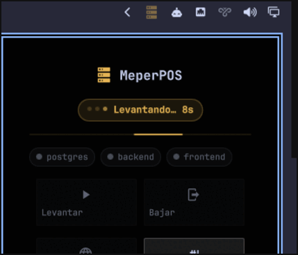
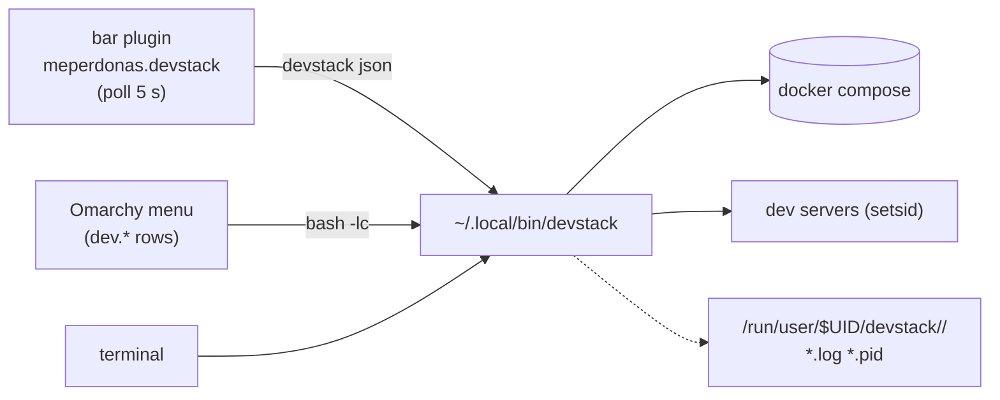

# devstack — local dev stacks for the Omarchy bar

[](https://github.com/MeperDonas/omarchy-devstack/actions/workflows/ci.yml)

One bar icon in the Omarchy bar (plus a menu section and a CLI) to lift, watch and
drop the local stack of a project: docker services, dev servers, health checks
and the browser, in order.

It ships as an **Omarchy plugin** (`bar-widget`), so it installs with
`omarchy plugin add`, updates with `omarchy plugin update` and is configured from
the Omarchy settings UI. Nothing is hardcoded to one project: you declare each
stack in a JSON file.


While an action runs the icon breathes and the panel shows the dots plus a slow
progress line, so you can see it is working instead of guessing:



The icon is grey when the stack is off, red on error, yellow while lifting and
green when every service answers.

## What it does

- **`up`** walks your services in order: `docker compose up -d` → wait for the
  port → start the dev server → wait for its health URL. Then it opens the
  browser **only if the frontend already answers**, so you never get a tab
  spinning while the bundler compiles the first route.
- **`down`** kills each process **group** (no orphan `nest`/`next` left) and
  brings docker down last. Data volumes are kept.
- **It never touches what it did not start.** A dev server you launched by hand
  is reported as `ajeno`/`ext` and left alone. When you want it out of the way,
  `--force` (or the contextual *Tomar el control* button) kills that PID — with a
  guard so it never kills its own process group.
- **Per-stage notifications** (`Compilando el backend…`, `Backend respondiendo
  (:3001)`, `Stack arriba en 42s`): you always know when it finished, and errors
  notify too.
- **Four-colour state** everywhere: the bar icon, the status chip and one chip
  per service.

| State | Colour | When |
|---|---|---|
| off | grey `#7A8394` | nothing is up |
| error | red `#E05561` | the probe failed, or a service listens and does not answer |
| working | yellow `#E5B454` | lifting / restarting / partially up / compiling the first route |
| ok | green `#7FBF7F` | every service with a health URL responds |

## Where this sits next to the neighbours

The marketplace already has plenty of plugins that *watch* docker or *find*
ports. This one is about **lifting a project's stack in order** — and that is a
different job:

| If you want to… | A plugin like… may be enough |
|---|---|
| see container state, logs, stats | the docker monitor plugins |
| find, open or kill a port that is already listening | the port-discovery plugins (Localhost, Omaports, Portboard, aportless) |
| toggle individual services/commands by hand | Services Manager |
| **declare one project, start its services in order, wait for real health, open the browser when it answers, and stop the whole thing without orphans** | devstack |

devstack also takes over a port that a stray dev server is holding (`--force`),
and never touches a process it did not start.

## Requirements

- Omarchy with plugin support (the bar widget is a `bar-widget` plugin). The CLI
  alone also runs on plain Arch/Hyprland: bash, `jq`, `curl`, `ss` (iproute2).
- `docker` only if you declare docker services.
- For docker without the `docker` group: `polkit` (the Omarchy dialog asks for
  the password) and/or `sudo`.

## Install

One command: the plugin carries the CLI and the example stacks inside the same
clone, so the widget works as soon as it is enabled.

```bash
omarchy plugin add https://github.com/MeperDonas/omarchy-devstack --enable
devstack init my-app        # creates ~/.config/devstack/my-app.json from the example
devstack my-app up          # once you edited dir + services
```

Already included, no extra steps: the widget's menu button, the shipped `demo`
stack (`devstack demo up`, a python http.server) and `example`.

Optional extras:

```bash
git clone https://github.com/MeperDonas/omarchy-devstack.git && cd omarchy-devstack
./install.sh --menu          # adds the Dev section to the Omarchy menu
./install.sh --project my-app   # points the widget at one project
```

`install.sh` is idempotent, updates the plugin when it is already installed, never
overwrites an existing config, and leaves a backup of every file it edits. Flags:
`--project NAME`, `--config FILE` (repeatable), `--menu`,
`--section left|center|right`, `--no-enable`, `--dry-run`.

Everything else is one `install` away if you want the CLI on `PATH`:

```bash
install -m755 ~/.config/omarchy/plugins/meperdonas.devstack/bin/devstack ~/.local/bin/devstack
```

Uninstall with `./uninstall.sh` (add `--keep-config` to keep your stacks).

## Try it in one minute (no docker, no node)

```bash
DEVDATA_CONFIG="$PWD/config" DEVDATA_PROJECT=demo bin/devstack demo up
```

`config/demo.json` is a single `python3 -m http.server` on `:8080`.

## Configure a stack

`~/.config/devstack/<name>.json`:

```json
{
  "name": "MeperPOS",
  "dir": "~/Projects/MeperPOS",
  "services": [
    { "id": "db", "label": "postgres", "type": "docker",
      "compose": "backend/docker-compose.yml", "container": "postgres-db",
      "port": 5432, "wait": 60 },

    { "id": "api", "label": "backend", "dir": "backend", "cmd": "npm run start:dev",
      "port": 3001, "health": "http://localhost:3001/api/health", "wait": 180 },

    { "id": "web", "label": "frontend", "dir": "frontend", "cmd": "npm run dev",
      "port": 3000, "health": "http://localhost:3000", "wait": 120, "open": true }
  ],
  "tasks": [
    { "id": "seed", "label": "Seed data", "dir": "backend",
      "cmd": "npm run seed", "needs": ["db"] }
  ]
}
```

| Field | Meaning |
|---|---|
| `id` | short id used by the CLI and the bar (`devstack myproject restart api`) |
| `label` | what you see in the chips and in `status` |
| `type` | `process` (default) or `docker` |
| `dir` | service working dir, relative to `dir` |
| `cmd` | command to run (`process`) — launched with `setsid`, logged to a pidfile |
| `compose` / `container` | compose file and container name (`docker`) |
| `port` | port that must open before the next service starts |
| `health` | URL polled until it answers 2xx; also drives the green state |
| `url` | URL to open with `devstack <p> open` (falls back to `health`) |
| `wait` | seconds to wait for port/health (scaled by `DEVDATA_WAIT_SCALE`) |
| `open` | `true` on the service the browser button should open |
| `tasks[].needs` | services to lift before running the task |

## CLI

```bash
devstack                          # list configured projects
devstack <p> up [--force]         # lift everything (--force takes foreign ports)
devstack <p> down [--keep-docker] [--force]
devstack <p> restart [id ...] [--force]
devstack <p> status               # per-service state, owner PID, URLs
devstack <p> json                 # machine-readable state (what the bar reads)
devstack <p> logs [id]            # follow logs
devstack <p> open [id]
devstack <p> task <id>            # seed, migrate, studio, …
devstack <p> up <id ...>          # lift only some services
devstack <p> list                 # declared services and tasks
devstack <p> menu                 # print the JSONC block for the Omarchy menu
devstack <p> --running | --up | --foreign   # guards for the menu
```

`DEVDATA_CONFIG` (config dir), `DEVDATA_PROJECT` (default project),
`DEVDATA_WAIT_SCALE` (multiply waits) and `DEVDATA_NOTIFY` (`all` | `final` |
`off`) override the defaults.

### Notifications

The panel already shows the progress (state chip, one chip per service, the
working animation), so notifications only carry the **outcome** when an action
comes from the bar: `Stack arriba en 42s`, `Stack parcial…`, or the error. That
is what keeps the popup from covering a pile of its own "compiling…" notices —
Omarchy anchors notifications next to the bar, exactly where the widget lives.

- `final` (default in the widget): only the outcome.
- `all`: every stage (useful from the menu or a terminal, where there is no panel).
- `off`: silence.

Set it per widget instance in the Omarchy settings UI (`notifyMode`) or with
`DEVDATA_NOTIFY` on any CLI call.

## Several projects on the bar

`allowMultiple` is on, so you can run one widget instance per project. Add the
widget again from the Omarchy settings UI (or `omarchy plugin enable
meperdonas.devstack --section right`) and give each instance its `project` in
`~/.config/omarchy/shell.json`:

```json
{ "id": "meperdonas.devstack", "project": "meperpos" },
{ "id": "meperdonas.devstack", "project": "other-app" }
```

The widget also reads the project the CLI resolved, so a single instance with no
`project` set follows whichever project is the default.

## How it is wired



## Caveats

- Services live **inside your user session** (`/run/user/$UID/devstack/`): a
  reboot or a session logout takes them down. That is intentional — nothing
  survives behind your back.
- `--force` kills processes that are not devstack's. It is opt-in for a reason.
- Health checks are plain HTTP; a service that answers slowly will read as
  "compiling" and turn yellow until it responds.

## License

MIT — see [LICENSE](LICENSE).

---

## Español

**Qué es.** Un icono en la barra de Omarchy (más una sección en el menú y un CLI)
para levantar, mirar y bajar el stack local de un proyecto: docker, servidores de
desarrollo, health checks y el navegador, en orden.

**Instalar.**

```bash
omarchy plugin add https://github.com/MeperDonas/omarchy-devstack --enable
devstack init mi-app        # crea ~/.config/devstack/mi-app.json desde el ejemplo
devstack mi-app up
```

El plugin trae adentro el CLI y los stacks de ejemplo, así que no hace falta
clonar ni copiar nada: el widget funciona apenas se habilita. Para el menú de
Omarchy: `./install.sh --menu`.

Es un **plugin de Omarchy** (`bar-widget`): se instala con `omarchy plugin add`,
se actualiza con `omarchy plugin update` y se configura desde los ajustes de
Omarchy. Para probarlo sin docker ni node: `DEVDATA_CONFIG="$PWD/config"
DEVDATA_PROJECT=demo bin/devstack demo up` (levanta un `python3 -m http.server`).
Desinstalar: `./uninstall.sh`.

**Configurar.** Un JSON por proyecto en `~/.config/devstack/<nombre>.json`
(nombre, directorio y `services` con `id`, `label`, `type` (`process`/`docker`),
`dir`, `cmd`, `port`, `health`, `url`, `wait`, `open`; más `tasks` opcionales).
Mirá la tabla de campos de arriba y `config/example.json`.

**Usar.** `devstack` lista los proyectos; `devstack <p> up|down|restart|status|
logs|open|task`. Desde la barra: un click y los botones. Cuatro colores: gris
apagado, rojo error, amarillo trabajando, verde arriba.

**Avisos.** El panel ya muestra el progreso, así que desde la barra sólo llega
el **resultado** (`final`, por defecto) y no una notificación por etapa que
además quedaría encima del panel. `all` para todo, `off` para silencio
(ajuste `notifyMode` del widget, o `DEVDATA_NOTIFY` en el CLI).

**Dónde encaja.** El marketplace ya tiene plugins que *miran* docker o *encuentran* puertos (Localhost, Omaports, Portboard, aportless, Services Manager). Este es para **levantar el stack de un proyecto en orden**: declarás los servicios, espera la salud real de cada uno, abre el navegador cuando contesta y baja todo sin dejar huérfanos.

**Lo importante.** No toca procesos que no levantó él (los marca `ajeno`/`ext`),
no deja `nest`/`next` huérfanos y avisa por notificación en cada etapa. Con
`--force` (o el botón *Tomar el control*) mata lo ajeno que ocupe un puerto.
