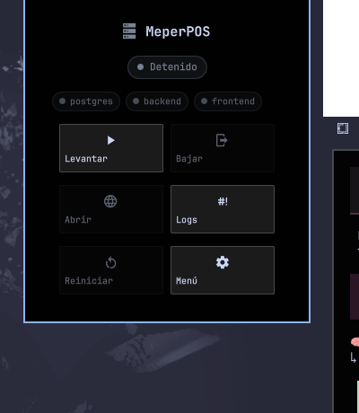
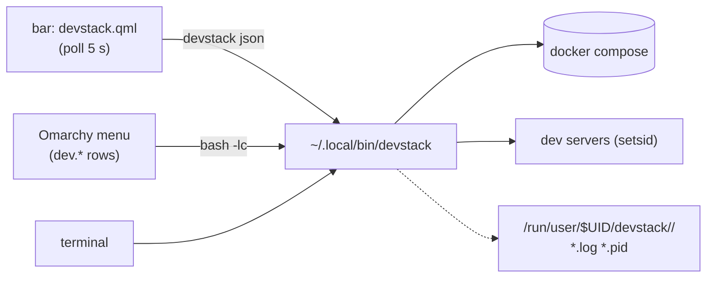

# devstack — local dev stacks for the Omarchy bar

One icon in the Omarchy bar (plus a menu section and a CLI) to lift, watch and
drop the local stack of a project: docker services, dev servers, health checks
and the browser, in order.

Built for [Omarchy](https://omarchy.org/) (Hyprland + Quickshell). Nothing is
hardcoded to one project: you declare each stack in a JSON file.



The icon is grey when the stack is off, red on error, yellow while lifting and
green when every service answers.

## What it does

- **`up`** walks your services in order: `docker compose up -d` → wait for the
  port → start the dev server → wait for its health URL. Then it opens the
  browser **only if the frontend already answers**, so you never get a tab
  spinning while the bundler compiles the first route.
- **`down`** kills each process **group** (no orphan `nest`/`next` left) and
  brings docker down last. Data volumes are kept.
- **It never touches what it did not start.** A dev server you launched by hand
  is reported as `ajeno`/`ext` and left alone. When you want it out of the way,
  `--force` (or the contextual *Tomar el control* button) kills that PID — with a
  guard so it never kills its own process group.
- **Per-stage notifications** (`Compilando el backend…`, `Backend respondiendo
  (:3001)`, `Stack arriba en 42s`): you always know when it finished, and errors
  notify too.
- **Four-colour state** everywhere: the bar icon, the status chip and one chip
  per service.

| State | Colour | When |
|---|---|---|
| off | grey `#7A8394` | nothing is up |
| error | red `#E05561` | the probe failed, or a service listens and does not answer |
| working | yellow `#E5B454` | lifting / restarting / partially up / compiling the first route |
| ok | green `#7FBF7F` | every service with a health URL responds |

## Requirements

- Omarchy (the bar widget uses the Quickshell bar API). The CLI also works on
  plain Hyprland/Arch, minus the bar module.
- `jq`, `curl`, `ss` (iproute2) — `docker` only if you declare docker services.
- For docker without the `docker` group: `polkit` (the Omarchy dialog asks for
  the password) and/or `sudo`.

## Install

```bash
git clone https://github.com/<you>/omarchy-devstack.git
cd omarchy-devstack

# script + bar module + config + bar entry + menu section
./install.sh --project myproject --config config/example.json --menu

omarchy restart shell
```

`install.sh` is idempotent, only replaces its own entries, and backs up every
file it edits (`~/.config/omarchy/shell.json.bak.<stamp>` and the same for the
menu). Flags:

| Flag | What it does |
|---|---|
| `--project NAME` | registers the bar widget for that project |
| `--config FILE` | copies a config into `~/.config/devstack/` |
| `--menu` | appends/refreshes the Dev section of the Omarchy menu |
| `--dry-run` | prints what it would do |

To uninstall: `./uninstall.sh` (removes the script, the module, its bar entry,
its menu block and its configs; keeps your docker volumes).

## Configure a stack

`~/.config/devstack/<name>.json`:

```json
{
  "name": "MeperPOS",
  "dir": "~/Projects/MeperPOS",
  "services": [
    { "id": "db", "label": "postgres", "type": "docker",
      "compose": "backend/docker-compose.yml", "container": "postgres-db",
      "port": 5432, "wait": 60 },

    { "id": "api", "label": "backend", "dir": "backend", "cmd": "npm run start:dev",
      "port": 3001, "health": "http://localhost:3001/api/health", "wait": 180 },

    { "id": "web", "label": "frontend", "dir": "frontend", "cmd": "npm run dev",
      "port": 3000, "health": "http://localhost:3000", "wait": 120, "open": true }
  ],
  "tasks": [
    { "id": "seed", "label": "Seed data", "dir": "backend",
      "cmd": "npm run seed", "needs": ["db"] }
  ]
}
```

| Field | Meaning |
|---|---|
| `id` | short id used by the CLI and the bar (`devstack myproject restart api`) |
| `label` | what you see in the chips and in `status` |
| `type` | `process` (default) or `docker` |
| `dir` | service working dir, relative to `dir` |
| `cmd` | command to run (`process`) — launched with `setsid`, logged to a pidfile |
| `compose` / `container` | compose file and container name (`docker`) |
| `port` | port that must open before the next service starts |
| `health` | URL polled until it answers 2xx; also drives the green state |
| `url` | URL to open with `devstack <p> open` (falls back to `health`) |
| `wait` | seconds to wait for port/health (scaled by `DEVDATA_WAIT_SCALE`) |
| `open` | `true` on the service the browser button should open |
| `tasks[].needs` | services to lift before running the task |

## CLI

```bash
devstack                          # list configured projects
devstack <p> up [--force]         # lift everything (--force takes foreign ports)
devstack <p> down [--keep-docker] [--force]
devstack <p> restart [id ...] [--force]
devstack <p> status               # per-service state, owner PID, URLs
devstack <p> json                 # machine-readable state (what the bar reads)
devstack <p> logs [id]            # follow logs
devstack <p> open [id]
devstack <p> task <id>            # seed, migrate, studio, …
devstack <p> up <id ...>          # lift only some services
devstack <p> list                 # declared services and tasks
devstack <p> menu                 # print the JSONC block for the Omarchy menu
devstack <p> --running | --up | --foreign   # guards for the menu
```

`DEVDATA_CONFIG` (config dir), `DEVDATA_PROJECT` (default project),
`DEVDATA_WAIT_SCALE` (multiply waits) override the defaults.

## Several projects on the bar

One widget instance per project, each with its own `project` key:

```json
{ "id": "devstack", "type": "qml",
  "source": "~/.config/omarchy/bar/modules/devstack.qml", "project": "meperpos" }
```

Add a second one with a different `id` and `project`, then
`omarchy restart shell`.

## How it is wired



## Caveats

- Services live **inside your user session** (`/run/user/$UID/devstack/`): a
  reboot or a session logout takes them down. That is intentional — nothing
  survives behind your back.
- `--force` kills processes that are not devstack's. It is opt-in for a reason.
- Health checks are plain HTTP; a service that answers slowly will read as
  "compiling" and turn yellow until it responds.

## License

MIT — see [LICENSE](LICENSE).

---

## Español

**Qué es.** Un icono en la barra de Omarchy (más una sección en el menú y un CLI)
para levantar, mirar y bajar el stack local de un proyecto: docker, servidores de
desarrollo, health checks y el navegador, en orden.

**Instalar.**

```bash
git clone https://github.com/<vos>/omarchy-devstack.git && cd omarchy-devstack
./install.sh --project miproyecto --config config/example.json --menu
omarchy restart shell
```

**Configurar.** Un JSON por proyecto en `~/.config/devstack/<nombre>.json`
(nombre, directorio y `services` con `id`, `label`, `type` (`process`/`docker`),
`dir`, `cmd`, `port`, `health`, `url`, `wait`, `open`; más `tasks` opcionales).
Mirá la tabla de campos de arriba y `config/example.json`.

**Usar.** `devstack` lista los proyectos; `devstack <p> up|down|restart|status|
logs|open|task`. Desde la barra: un click y los botones. Cuatro colores: gris
apagado, rojo error, amarillo trabajando, verde arriba.

**Lo importante.** No toca procesos que no levantó él (los marca `ajeno`/`ext`),
no deja `nest`/`next` huérfanos y avisa por notificación en cada etapa. Con
`--force` (o el botón *Tomar el control*) mata lo ajeno que ocupe un puerto.
